# BGH Pro Max 3.0 – Dokumentation

**Streitstand-Assistent für Wohnraummietsachen am Amtsgericht**

Diese Dokumentation beschreibt die Anwendung in der Datei [`streitstand_v3_1.html`](streitstand_v3_1.html). Sie richtet sich in erster Linie an **Juristinnen und Juristen**, die mit der Anwendung arbeiten, ihre Ergebnisse einordnen oder das hinterlegte rechtliche Regelmodell prüfen sollen.

> **Zur Lesart:** Technische Einzelheiten, die nur für die Wartung und Weiterentwicklung wichtig sind, stehen in aufklappbaren Kästen mit der Überschrift **„🔧 Exkurs für Informatiker“**. Diese Kästen können Sie überspringen; für das Verständnis der Anwendung sind sie nicht nötig. Am Ende befindet sich zusätzlich ein zusammenhängender [technischer Anhang](#12-technischer-anhang-exkurs-für-informatiker).

---

## Inhalt

1. [Worum geht es?](#1-worum-geht-es)
2. [Leitlinien: Was die Anwendung tut – und was nicht](#2-leitlinien-was-die-anwendung-tut--und-was-nicht)
3. [Das rechtliche Regelmodell](#3-das-rechtliche-regelmodell)
4. [Arbeitsablauf Schritt für Schritt](#4-arbeitsablauf-schritt-für-schritt)
5. [Das Ergebnis lesen: Streitstand, Status, Beweislast](#5-das-ergebnis-lesen-streitstand-status-beweislast)
6. [Prüfung eines Merkmals (Prüfungsschema)](#6-prüfung-eines-merkmals-prüfungsschema)
7. [Rechtsprechungsrecherche](#7-rechtsprechungsrecherche)
8. [Begründungsgerüst](#8-begründungsgerüst)
9. [Prozessdiagramme der juristischen Logik](#9-prozessdiagramme-der-juristischen-logik)
10. [Datenschutz, Vertraulichkeit, Speicherort](#10-datenschutz-vertraulichkeit-speicherort)
11. [Grenzen und Fehlerquellen](#11-grenzen-und-fehlerquellen)
12. [Technischer Anhang (Exkurs für Informatiker)](#12-technischer-anhang-exkurs-für-informatiker)
13. [Glossar](#13-glossar)

---

## 1. Worum geht es?

BGH Pro Max ist ein Hilfsmittel für Richterinnen und Richter in **Wohnraummietsachen**. Es liest die elektronische Akte (Schriftsätze und Anlagen) und stellt den **Streitstand nach der Relationstechnik** dar:

- **je Tatbestandsmerkmal** (z. B. „Mangel der Mietsache“, „Ernsthafter Nutzungswille“),
- **Vortrag der Klagepartei** und **Erwiderung der beklagten Partei** nebeneinander,
- mit einem **Status** nach der ZPO (unstreitig, bestritten, mit Nichtwissen bestritten …),
- mit der **Beweislast** laut Regelmodell,
- mit den **Beweisangeboten** der Parteien und einem Hinweis auf **Beweislücken**.

Der wichtigste Grundsatz: **Jede Angabe ist mit einer wörtlichen Fundstelle belegt.** Ein Klick auf einen Vortrag öffnet rechts das Originaldokument und markiert die zitierte Stelle. So lässt sich jede Behauptung der Anwendung sofort am Aktenoriginal überprüfen.

Ergänzend bietet die Anwendung

- ein **Prüfungsschema** je Merkmal (Obersatz, Definition, Prüfschritte, Streitstände), in dem das Gericht Prüfvermerke setzen kann,
- eine **Recherche in der amtlichen Rechtsprechungsdatenbank des Bundes**,
- ein druckbares **Begründungsgerüst** als Gliederung für die Entscheidungsgründe.

Einen Gesamtüberblick über den Ablauf und das Prüfprogramm geben die **Prozessdiagramme in [Abschnitt 9](#9-prozessdiagramme-der-juristischen-logik)**.

Derzeit sind zwei Verfahrensarten hinterlegt:

| Verfahrensart | Klagepartei | Beklagte Partei |
|---|---|---|
| Mietminderung / Rückzahlung / Mängelbeseitigung | Mieter | Vermieter |
| Räumung nach Eigenbedarfskündigung | Vermieter | Mieter |

---

## 2. Leitlinien: Was die Anwendung tut – und was nicht

Die Anwendung ist bewusst als **Erfassungs- und Strukturierungswerkzeug** angelegt, nicht als Entscheidungshilfe im Sinne einer Bewertung.

**Die Anwendung**

- erfasst und ordnet den Parteivortrag,
- belegt jede Angabe mit einem wörtlichen Zitat aus der Akte,
- schlägt eine Prüfungsstruktur vor (im **Konjunktiv** formuliert),
- zeigt Rechtsprechung **nur**, wenn sie in der amtlichen Datenbank tatsächlich gefunden wurde.

**Die Anwendung**

- **entscheidet nicht**, wer Recht hat,
- **würdigt keine Beweise**,
- **formuliert keine Würdigung** – im Begründungsgerüst steht an dieser Stelle ein Platzhalter „[… Würdigung durch das Gericht …]“,
- **erfindet keine Urteile**: Die KI darf lediglich Suchbegriffe vorschlagen; angezeigt werden ausschließlich echte Treffer der amtlichen Datenbank.

Die **Beweislast** wird nicht von der KI bestimmt, sondern ausschließlich aus dem fest hinterlegten Regelmodell übernommen (siehe Abschnitt 3).

Alles, was vom Gericht gesetzt wird (Prüfvermerke, korrigierter Status, Notizen, angeheftete Entscheidungen), wird in der Anwendung ausdrücklich als Angabe des Gerichts gekennzeichnet und von den KI-Vorschlägen unterschieden.

---

## 3. Das rechtliche Regelmodell

Das Herzstück der Anwendung ist ein **fest hinterlegtes Prüfprogramm** je Verfahrensart. Es legt fest,

- welche Tatbestandsmerkmale geprüft werden,
- in welche Prüfungsgruppen sie gegliedert sind,
- welche Norm einschlägig ist,
- **wer die Beweislast trägt**,
- welche Merkmale je Mangel gesondert zu erfassen sind,
- welches Prüfungsschema (Obersatz, Definition, Prüfschritte) angezeigt wird.

Die KI füllt dieses Raster lediglich mit dem Parteivortrag aus. Sie kann keine Merkmale hinzufügen oder die Beweislast ändern. (Einzige Ausnahme: Unter „Weitere streitige Punkte“ darf die KI bis zu **vier** zusätzliche streitige Tatsachen erfassen, die keinem Merkmal zuzuordnen sind – diese erscheinen getrennt und ohne Beweislast.)

> **⚑ Verifikationsvorbehalt:** Das Regelmodell ist vom Entwicklungsteam erstellt und **juristisch gegenzulesen**. Merkmale, Prüfschritte und Beweislastregeln, deren rechtliche Grundlage unsicher oder nicht aus dem zugrunde liegenden Mietrechts-Skript belegt ist, tragen in der Oberfläche den Vermerk **„⚑ vom Team zu verifizieren“**.

### 3.1 Mietminderung / Rückzahlung / Mängelbeseitigung

Klagepartei = Mieter, beklagte Partei = Vermieter.

| Gruppe | Merkmal | Norm | Beweislast | Hinweise |
|---|---|---|---|---|
| **G1 Mietverhältnis und Zahlung** | Mietvertrag und Miethöhe | § 535 BGB | Mieter | |
| | Zahlung der ungeminderten Miete | § 812 Abs. 1 S. 1 Alt. 1 BGB | Mieter | |
| | Vorbehalt / Kenntnis der Nichtschuld | § 814 BGB | Vermieter | Einwendung des Vermieters; ein Zahlungsvorbehalt spricht dagegen |
| **G2 Mangel** (je Mangel eine eigene Zeile) | Mangel der Mietsache | § 536 Abs. 1 BGB (nach Annahme, § 363 BGB) | Mieter | |
| | Ursache / Verantwortungsbereich | Sphärentheorie (Rspr.) | **gestuft** | zuerst Vermieter (Ursache nicht in Bausubstanz), dann Mieter (nicht im Wohnverhalten); ⚑ zu verifizieren |
| | Erheblichkeit der Beeinträchtigung | § 536 Abs. 1 S. 3 BGB | Vermieter | Unerheblichkeit ist als Ausnahme formuliert |
| | Mängelanzeige | § 536c BGB | Vermieter | für Unterlassen der Anzeige und Kausalität; ⚑ zu verifizieren |
| **G3 Umfang, Einwendungen, Beseitigung** | Zeitraum und Höhe der Minderung | § 536 Abs. 1 BGB; § 287 ZPO | Mieter | |
| | Vereitelung der Mangelbeseitigung (Zutritt) | § 242 BGB | Vermieter | |
| | Anspruch auf Mangelbeseitigung | § 535 Abs. 1 S. 2 BGB | Mieter | |
| **G4 Weitere Anspruchsgrundlagen** (optional) | Schadensersatz wegen Mangels | § 536a Abs. 1 BGB | Mieter | ⚑ zu verifizieren |
| | Aufwendungsersatz nach Selbstvornahme | § 536a Abs. 2 BGB | Mieter | ⚑ zu verifizieren |
| | Fristlose Kündigung durch den Mieter | § 543 Abs. 2 S. 1 Nr. 1, Abs. 3 BGB | Mieter | ⚑ zu verifizieren |

**Optionale Gruppe G4:** Sie wird nur analysiert, wenn das Gericht sie für die Akte ausdrücklich einschaltet (Häkchen „bei der nächsten Analyse einbeziehen“). Auch ohne Analyse stehen Prüfungsschema und Rechtsprechungssuche zur Verfügung. Die Gruppe trägt den Hinweis zur Konkurrenz: Nach Überlassung dürften die §§ 536 ff. BGB das allgemeine Leistungsstörungsrecht verdrängen (Ausnahmen: arglistiges Verschweigen; Untergang der Mietsache durch Verschulden des Mieters, § 326 Abs. 2 BGB).

### 3.2 Räumung nach Eigenbedarfskündigung

Klagepartei = Vermieter, beklagte Partei = Mieter.

| Gruppe | Merkmal | Norm | Beweislast | Hinweise |
|---|---|---|---|---|
| **G1 Wirksame Kündigung** | Mietverhältnis, Überlassung | §§ 535, 546 Abs. 1 BGB | Vermieter | |
| | Schriftform der Kündigung | §§ 568 Abs. 1, 126 BGB | Vermieter | |
| | Zugang der Kündigung | § 130 BGB | Vermieter | |
| | Angabe der Gründe im Schreiben | § 573 Abs. 3 BGB | Vermieter | |
| | Kündigungsfrist / Beendigungszeitpunkt | § 573c Abs. 1 BGB | Vermieter | |
| | Befristetes Mietverhältnis | § 575 BGB | Vermieter | **nur**, wenn die Akte eine Befristung erwähnt; ⚑ zu verifizieren |
| **G2 Eigenbedarf** | Bedarfsperson (Angehörige) | § 573 Abs. 2 Nr. 2 BGB | Vermieter | |
| | Ernsthafter Nutzungswille | § 573 Abs. 2 Nr. 2 BGB | Vermieter | |
| | Vernünftige, nachvollziehbare Gründe | § 573 Abs. 2 Nr. 2 BGB | Vermieter | |
| | Alternativwohnung / Anbietpflicht | § 242 BGB (Rechtsmissbrauch) | Mieter | sekundäre Darlegungslast des Vermieters zu seinem Wohnungsbestand; ⚑ zu verifizieren – siehe den Hinweis zur BGH-Rechtsprechung in [9.7](#97-prüfungsaufbau-räumung-nach-eigenbedarfskündigung) |
| | Kündigungssperre nach Umwandlung | § 577a BGB | Mieter | |
| **G3 Widerspruch und Härte** | Widerspruch: Form und Frist | § 574b BGB (Hinweis § 568 Abs. 2) | Mieter | |
| | Härtegründe | § 574 Abs. 1 BGB | Mieter | |
| | Kein zumutbarer Ersatzwohnraum | § 574 Abs. 2 BGB | Mieter | |

Die Gruppe „Eigenbedarf“ trägt den Hinweis auf die mittelbare Drittwirkung der Grundrechte: Eigentum des Vermieters und Besitzrecht des Mieters stehen beide unter dem Schutz des Art. 14 GG (BVerfG).

Das Merkmal „Befristetes Mietverhältnis“ wird nur geprüft, wenn in der Akte von einer Befristung, einem Zeitmietvertrag oder § 575 BGB die Rede ist. „Unbefristet“ löst die Prüfung nicht aus.

### 3.3 Antragstypen

Die Anwendung gliedert den Streitstand nach den **Klageanträgen**. Für jeden Antragstyp ist hinterlegt, welche Merkmale für ihn zu prüfen sind (⚑ Zuordnung vom Team zu verifizieren):

| Verfahrensart | Antragstyp | Norm | Zu prüfende Merkmale |
|---|---|---|---|
| Minderung | Mängelbeseitigung | § 535 Abs. 1 S. 2 BGB | Mietvertrag, Mangel, Ursache, Vereitelung, Beseitigung |
| | Rückzahlung überzahlter Miete | § 812 Abs. 1 S. 1 Alt. 1 i. V. m. § 536 Abs. 1 BGB | Mietvertrag, Zahlung, Vorbehalt, Mangel, Ursache, Erheblichkeit, Anzeige, Zeitraum/Höhe, Vereitelung |
| | Feststellung der Minderung | § 536 Abs. 1 BGB, § 256 ZPO | Mietvertrag, Mangel, Ursache, Erheblichkeit, Anzeige, Zeitraum/Höhe, Vereitelung |
| | Schadens- bzw. Aufwendungsersatz | § 536a BGB | Mietvertrag, Mangel, Ursache, Schadensersatz, Selbstvornahme |
| Räumung | Räumung und Herausgabe | §§ 546 Abs. 1, 985 BGB | alle Merkmale |

Die KI erfasst die gestellten Anträge beider Parteien (mit Fundstelle) und ordnet jeden Klageantrag einem dieser Typen zu. Erfasst die Analyse keine Anträge, leitet die Anwendung sie hilfsweise aus dem Vortrag ab und weist ausdrücklich darauf hin („aus dem Regelmodell abgeleitet“).

🔧 Exkurs für Informatiker: Wo das Regelmodell im Code steht

- `RULES` (`streitstand_v3_1.html:485`) – Gruppen und Merkmale je Verfahrensart. Felder: `id`, `label`, `norm`, `last` (`'mieter' | 'vermieter' | 'gestuft'`), `lastText`, `hint` (wird der KI als Erläuterung mitgegeben), `multi` (je Mangel eine Zeile), `verify`, `nurWenn` (regulärer Ausdruck über den Aktentext), bei Gruppen `optional`, `info`, `infoQuelle`.
- `PRUEFUNG` (`streitstand_v3_1.html:554`) – Prüfungsschemata je Merkmal (siehe Abschnitt 6); wird beim Laden an `RULES[...].merkmale[].pruefung` gehängt (`:789`).
- `ANTRAEGE` (`streitstand_v3_1.html:796`) – Antragstypen; `kenn` = Merkmal, an dessen Vortrag ein Antrag hilfsweise erkannt wird; `merkmale: null` = alle.
- `STATUS` (`streitstand_v3_1.html:808`) – Statuswerte mit `needsProof`.
- `RSP_TERMS` (`streitstand_v3_1.html:841`) – Startsuchbegriffe für die Rechtsprechungssuche je Merkmal.

Die Beweislast-Zuordnung zur Prozesspartei erfolgt in `sideOf()` (`:2111`): `'mieter'`/`'vermieter'` wird über `klaegerRolle` auf Kläger oder Beklagten abgebildet; `'gestuft'` ergibt keine Partei.

Eine neue Verfahrensart erfordert Einträge in `RULES`, `PRUEFUNG`, `ANTRAEGE`, `RSP_TERMS` sowie eine Anpassung von `verfahrenFromText()` (`:1200`) und der Auswahlliste in `renderSide()` (`:2139`) bzw. des Umschalters `btnVerfahren` (`:2749`), der derzeit nur zwischen zwei Verfahrensarten wechselt.

---

## 4. Arbeitsablauf Schritt für Schritt

### 4.1 Start

Die Anwendung ist eine einzelne Datei, die im Webbrowser geöffnet wird (lokal per Doppelklick oder als veröffentlichte Seite in Claude). Eine Installation ist nicht nötig. Beim ersten Start der Online-Version wird – sofern vorhanden – eine **Beispielakte „Westring“** (Mira Fink ./. Erik Weber, Mietminderung) mit vorab erstellter Analyse geladen.

Die Bildschirmaufteilung:

- **links** die Aktenliste,
- **Mitte** der Streitstand,
- **rechts** (bei Bedarf) das Seitenpanel mit Originaldokument, Prüfung oder Rechtsprechung.

### 4.2 Akte anlegen

Über **„＋ Neue Akte“** werden erfasst:

- **Aktenzeichen** (Pflichtfeld),
- Namen von **Kläger** und **Beklagtem**,
- **Verfahrensart** – entweder ausdrücklich gewählt oder „automatisch erkennen“,
- der **Aktenordner** (ganzer Ordner) oder einzelne **Dateien**.

**Unterstützte Dateiformate:**

| Art | Formate |
|---|---|
| Text | `.md`, `.markdown`, `.txt`, `.eml`, `.csv` |
| PDF | `.pdf` (mit Textebene oder als Scan) |
| Bilder | `.png`, `.jpg`, `.jpeg`, `.webp`, `.gif`, `.bmp` |
| Archive | `.zip` (wird automatisch entpackt, auch verschachtelt) |

Nicht unterstützte Dateien (z. B. Word-Dokumente) werden übersprungen; die Anwendung nennt sie ausdrücklich.

**Automatische Erkennung der Verfahrensart:** Kommen in Dateinamen oder Text die Wörter „Räumung“, „Eigenbedarf“ oder „Herausgabe der Wohnung“ vor, wird „Räumung nach Eigenbedarfskündigung“ angenommen, sonst „Mietminderung“. Diese Erkennung ist bewusst einfach; die Verfahrensart lässt sich jederzeit über das Menü **⋯ → „Verfahrensart … umstellen“** ändern.

### 4.3 Dokumentkennungen

Jedes Dokument erhält eine kurze Kennung, unter der es in Fundstellen zitiert wird:

- Enthält der Dateiname eine Kennung aus **ein bis zwei Großbuchstaben und zwei Ziffern** (z. B. `K01`, `B03`, `M04`), wird diese übernommen – praktisch für Anlagen „K 1“, „B 3“ usw.
- Textdateien können die Kennung auch im Dateikopf angeben (`document_id`), ebenso Titel, Datum und Release.
- Dateien **ohne** Kennung (z. B. `01_Klageschrift.pdf`) erhalten fortlaufend `S01`, `S02` …
- Liegt dasselbe Dokument in mehreren Fassungen vor (z. B. als PDF und als Text), werden diese zusammengeführt; in der Vorschau kann zwischen „PDF“, „Text“ und „Bild“ gewechselt werden.
- Mehrere Dateien mit gleicher Kennung, aber unterschiedlichem Namensrest (z. B. `K03_Foto_1.png`, `K03_Foto_2.png`) werden als eigene Dokumente `K03`, `K03-2` geführt.

Die Übersicht **„Dokumente“** zeigt alle eingelesenen Dokumente mit Kennung, Titel, Datum, Fassungen und Lesbarkeit.

### 4.4 Lesen der Dokumente und Texterkennung

Vor der Analyse liest die Anwendung jedes Dokument:

1. Textdateien werden direkt gelesen.
2. Bei PDF-Dateien wird die Textebene ausgelesen.
3. Hat eine PDF-Seite keine Textebene (Scan) oder handelt es sich um ein Bild, läuft eine **automatische Texterkennung (OCR)** für deutsche Sprache.

In der Dokumentübersicht zeigt die Spalte „Lesbarkeit“, woher der Text stammt („Text ✓“, „OCR ✓“, „Text + OCR ✓“) und wie viele Zeichen erkannt wurden. Wurde kaum Text erkannt, erscheint **„⚠ kaum Text“** – solche Dokumente fließen nicht oder nur unvollständig in die Analyse ein; die Anwendung weist darauf hin.

### 4.5 Rolle der Dokumente: Schriftsatz oder Anlage?

Für die Relationstechnik ist entscheidend, **was Parteivortrag ist** und **was Beweismittel ist**. Die Anwendung unterscheidet daher:

- **Schriftsatz der Klagepartei** (Klageschrift, Replik),
- **Schriftsatz der beklagten Partei** (Klageerwiderung, Duplik),
- **Anlage / Sonstiges** (Verträge, E-Mails, Chats, Fotos, Erklärungen Dritter, gerichtliche Verfügungen …).

Die Rolle wird automatisch erkannt – zunächst am Titel bzw. Dateinamen („Klageschrift“, „Replik“, „Erwiderung“, „Duplik“ …), sonst an typischen Formulierungen im Text („in Vollmacht des Klägers“, „erheben wir … Klage“, „die Klage abzuweisen“ …). Gerichtliche Dokumente (Beschluss, Verfügung, Urteil, Protokoll ohne Anwaltsbezug) gelten als „Sonstiges“.

**Die automatische Erkennung kann in der Dokumentübersicht für jedes Dokument korrigiert werden** (Spalte „Rolle“). Nach einer Änderung muss neu analysiert werden.

Die Rolle wirkt sich unmittelbar aus:

- Vortrag aus einem Schriftsatz der Klagepartei wird **zwingend** der Klägerspalte zugeordnet und umgekehrt – auch wenn die KI ihn falsch einsortiert hat.
- Anlagen gelten grundsätzlich **nicht als Vortrag**, sondern als Beweismittel der Partei, die sie vorlegt. Nur wenn eine Partei zu einem Punkt noch gar keinen Schriftsatz hat, darf ihre eigene Äußerung in einer Anlage (z. B. ihr eigenes Schreiben) als Vortrag dienen.
- Liegt **kein Schriftsatz der beklagten Partei** vor, setzt die Anwendung alle Status auf **„offen“** (siehe 5.2).

### 4.6 Streitstand analysieren

Mit **„▶ Streitstand analysieren“** startet die Auswertung. Die Anwendung

1. stellt alle lesbaren Dokumente zusammen,
2. befragt die KI **je Prüfungsgruppe** des Regelmodells nach dem Vortrag beider Parteien, dem Status und den Beweisangeboten,
3. befragt die KI gesondert nach den **gestellten Anträgen**,
4. lässt bis zu vier **weitere streitige Punkte** außerhalb des Prüfprogramms erfassen,
5. **prüft jedes einzelne Zitat** gegen den Originaltext (siehe 4.7),
6. legt für **jedes Merkmal** des Regelmodells eine Zeile an – auch wenn die KI dazu nichts gefunden hat („Die Analyse hat zu diesem Merkmal keine Fundstelle ermittelt – bitte selbst prüfen.“).

Während der Analyse wird der Zwischenstand bereits angezeigt. Scheitern alle Anfragen, wird **nichts** gespeichert – eine frühere Analyse bleibt dann erhalten.

Die KI arbeitet nach festen, ihr vorgegebenen Regeln. Die wichtigsten (sinngemäß):

- ausschließlich Informationen aus den Dokumenten; **nichts erfinden** (keine Tatsachen, Urteile, Quoten, Normen),
- jede Angabe mit Dokumentkennung und **wörtlichem Zitat** von 4 bis 30 Wörtern aus genau einem Dokument,
- eine sachliche Kurzfassung des Vortrags in höchstens 14 Wörtern,
- Status nach den ZPO-Kategorien (siehe 5.2) mit einem Satz Begründung,
- Beweisangebote nur bei **ausdrücklichem Beweisantritt**; „Zeugnis N. N.“ ist immer Zeugenbeweis; eine private schriftliche Erklärung einer Person ist Urkunde, kein Zeugenbeweis – außer die Person wird als Zeuge benannt,
- keine Doppelungen.

🔧 Exkurs für Informatiker: Ablauf der Analyse

- Einstieg: `runAnalysis()` (`streitstand_v3_1.html:1418`).
- Systemanweisung an das Modell: `SYSTEM_PROMPT` (`:1212`); Antwortschema `SCHEMA` (`:1240`); Prompt-Bausteine `gruppePrompt()`, `merkmalPrompt()`, `antraegePrompt()`, `zusatzPrompt()`.
- Die Dokumente werden als Textblöcke mit Kopfzeile (`### Dokument K01 | Titel | Datum | SCHRIFTSATZ der Klagepartei`) und Zeilenmarkern (`[M01:L02]` bei Markdown, `[S.3]` bei PDF-Seiten) übergeben (`docBlock()`, `:1234`).
- Ein Aufruf **je Prüfungsgruppe** (nicht je Merkmal), damit Mängel innerhalb einer Gruppe einheitlich benannt werden. Schlägt ein Gruppenaufruf fehl, folgt als Rückfall eine Einzelabfrage je Merkmal; das erste „je Mangel“-Merkmal legt die Mängelbezeichnungen fest, die dann vorgegeben werden.
- Parallelität: bei OpenRouter alle Gruppen gleichzeitig, bei Claude höchstens 3 (`pool()`, `:1403`).
- Wiederholung: Jede Anfrage wird bei nicht endgültigen Fehlern (z. B. abgeschnittenes JSON) einmal wiederholt, bei Ratenbegrenzung nach 8 s (`ask()`, `:1408`).
- Optionale Gruppen nur, wenn `akte.optGroups` sie enthält; Merkmale mit `nurWenn` nur, wenn der reguläre Ausdruck auf den Gesamttext passt.
- Deterministische Nachbearbeitung: Seitenkorrektur anhand der Dokumentrolle (`take()` → `move()`), Deduplizierung, Statuskorrektur ohne Klageerwiderung, Sortierung nach Regelmodell.
- Temperatur 0 bei OpenRouter; bei Claude die Stufe „schnell“/„gründlich“ (`modelTier`).

### 4.7 Der „Anker-Wächter“: Prüfung jedes Zitats

Damit die KI keine Fundstellen erfindet, wird **jedes Zitat automatisch gegen den Originaltext geprüft**:

- Gefunden im genannten Dokument → die Angabe wird übernommen; die Fundstelle erscheint als blaues Kürzel (z. B. `M01:L04` = Dokument M01, Zeile 4, oder `K01 S.3` = Dokument K01, Seite 3).
- Gefunden in einem **anderen** Dokument → die Angabe wird übernommen, die Fundstelle aber **korrigiert**; das Kürzel erscheint **gelb**, und der Hinweistext nennt das ursprünglich von der KI angegebene Dokument.
- **Nirgends** wörtlich gefunden → die Angabe wird **verworfen**. Verworfene Angaben erscheinen nicht in der Tabelle, sondern unten im aufklappbaren Bereich **„Verworfene KI-Angaben“** – mit dem angeblichen Zitat, damit das Gericht nachvollziehen kann, was ausgesondert wurde.

Beim Vergleich zählen nur Buchstaben und Ziffern; Groß-/Kleinschreibung, Satzzeichen, Zeilenumbrüche, Silbentrennung und Anführungszeichen werden ignoriert. Auslassungen im Zitat („…“, „[…]“) sind erlaubt, sofern die Teilstücke in der richtigen Reihenfolge vorkommen.

**Wichtig:** Der Anker-Wächter stellt sicher, dass das **Zitat** in der Akte steht. Er prüft **nicht**, ob die **Kurzfassung** der KI das Zitat zutreffend wiedergibt, ob der **Status** richtig gewählt ist oder ob das Zitat zum Merkmal passt. Diese Kontrolle bleibt beim Gericht (siehe Abschnitt 11).

🔧 Exkurs für Informatiker: Zitatsuche

- `verifyItem()` (`streitstand_v3_1.html:1386`) prüft zuerst das genannte Dokument, dann alle anderen; Treffer in einem anderen Dokument setzen `fixed`.
- `findQuote()` (`:946`) normalisiert über `normChar()` (nur `[a-z0-9äöüß]`, NFC, Kleinbuchstaben) und baut einen Index mit Rückabbildung auf die Textsegmente; Ellipsen teilen das Zitat in Teilstücke (je ≥ 4 Zeichen, zusammen ≥ 10 Zeichen), die in Reihenfolge gesucht werden.
- Bei der Analyse wird **nur exakt** (nach Normalisierung) gesucht. In der Vorschau gibt es zusätzlich eine unscharfe Suche (Anfang bzw. Ende des Zitats mit 75 %, 60 %, 45 % der Länge); ein solcher Treffer wird als „≈ ungefähre Stelle – bitte prüfen“ ausgewiesen.

### 4.8 Nachgereichte Schriftsätze und erneute Analyse

Über **⋯ → „Ordner neu einlesen“** wird der (ergänzte) Aktenordner erneut gewählt. Die Anwendung erkennt **neue Dokumente**, markiert sie mit **NEU** und fordert zur erneuten Analyse auf.

Bei der erneuten Analyse

- werden Zeilen, die sich gegenüber der vorherigen Analyse geändert haben (Status, zitierte Dokumente oder Zahl der Beweisangebote), mit **GEÄNDERT** markiert, neue Zeilen mit **NEU**;
- werden Angaben, die auf neue Dokumente gestützt sind, mit **NEU** markiert;
- **wandern die Prüfvermerke des Gerichts mit** (Häkchen, Status, Notizen, angeheftete Entscheidungen), soweit die Zeile wiedererkannt wird;
- steht der Filter **„Neu / geändert“** zur Verfügung.

### 4.9 Weitere Funktionen der Akte

- **Analyse exportieren (JSON):** sichert Analyse und Prüfvermerke als Datei. (Funktioniert nur in der in Claude veröffentlichten Fassung.)
- **Analyse importieren:** übernimmt Analyse, Prüfvermerke und zwischengespeicherte Rechtsprechung aus einer solchen Datei in die aktuelle Akte.
- **Akte entfernen:** löscht die Akte samt gespeicherter Dokumente nach Rückfrage aus dem Browser.

---

## 5. Das Ergebnis lesen: Streitstand, Status, Beweislast

### 5.1 Ansichten und Filter

Es gibt zwei Ansichten:

- **„Nach Anträgen“** (Standard): Je Klageantrag eine Kachel mit Nummer, Kurzbezeichnung, Antragstyp und Norm. Ein Klick blendet die zugehörigen Merkmale ein; jedes Merkmal lässt sich aufklappen und zeigt Vortrag, Erwiderung, Status, Beweislast und Beweisangebote. Merkmale, die mehrere Anträge betreffen, tragen den Hinweis „auch Antrag 2“ usw. Daneben gibt es Kacheln für „Weitere Merkmale“ (keinem Antrag zugeordnet), „Weitere streitige Punkte“ (von der KI zusätzlich erfasst) und optionale, noch nicht analysierte Gruppen. Die Anträge der beklagten Partei (z. B. Klageabweisung) werden in der Kopfzeile genannt.
- **„Gesamttabelle“**: alle Merkmale in einer Tabelle mit den Spalten *Merkmal · Kläger trägt vor · Beklagter erwidert · Status · Beweislast · Beweisangebote*.

Kläger erscheinen durchgehend in **Blau**, Beklagte in **Orange**.

Filter:

| Filter | Zeigt |
|---|---|
| Alle | alle Prüfpunkte |
| Beweisbedürftig | Punkte mit Status „bestritten“, „Nichtwissen“ oder „pauschal bestritten“ |
| Beweislücken | beweisbedürftige Punkte, zu denen die beweisbelastete Partei keinen Beweis angeboten hat |
| Neu / geändert | nur nach erneuter Analyse: neue oder veränderte Punkte |

### 5.2 Status

| Status (Anzeige) | Bedeutung | Beweisbedürftig? |
|---|---|---|
| **unstreitig** | von der Gegenseite ausdrücklich zugestanden (§ 288 ZPO) | nein |
| **nicht bestritten** | Gegenseite hat sich eingelassen, äußert sich zu diesem Punkt aber nicht (§ 138 Abs. 3 ZPO) | nein |
| **bestritten** | substantiiert bestritten | **ja** |
| **Nichtwissen** | mit Nichtwissen bestritten (§ 138 Abs. 4 ZPO) | **ja** |
| **pauschal bestritten** | nur pauschal / unsubstantiiert bestritten – **Erheblichkeit prüfen** | **ja** (vorsorglich) |
| **Rechtsfrage** | Tatsachen unstreitig, nur die rechtliche Bewertung ist streitig | nein |
| **offen** | noch keine Klageerwiderung / Einlassung | nein |
| **nicht vorgetragen** | keine Partei trägt hierzu etwas vor | nein |

Erläuterungen:

- Den Status schlägt die KI vor; ihre Begründung erscheint beim Überfahren des Status mit der Maus bzw. in der aufgeklappten Zeile.
- **„Pauschal bestritten“** wird vorsorglich als beweisbedürftig behandelt. Ob das Bestreiten nach § 138 Abs. 2 ZPO unbeachtlich ist (mit der Folge des § 138 Abs. 3 ZPO), ist eine Frage der rechtlichen Würdigung, die die Anwendung bewusst dem Gericht überlässt.
- **Ohne Schriftsatz der beklagten Partei** gibt es weder ein Zugestehen (§ 288 ZPO) noch ein Nichtbestreiten (§ 138 Abs. 3 ZPO). Die Anwendung setzt dann alle Punkte mit Vortrag deterministisch auf „offen“ – unabhängig vom KI-Vorschlag.
- Für das Merkmal „Härtegründe“ (Räumung) ist ein zusätzlicher Bewertungshinweis hinterlegt, der auch der KI mitgegeben wird: Gesundheitliche Härtegründe gelten nicht schon deshalb als unsubstantiiert, weil kein fachärztliches Attest vorliegt; die Anforderungen an den Vortrag dürfen nicht überspannt werden.
- Das Gericht kann den Status im Prüfungsbereich **korrigieren** (siehe 6.2). Ein korrigierter Status wird überall verwendet und als „vom Gericht geändert (KI: …)“ bzw. mit ✎ gekennzeichnet.

### 5.3 Beweislast und Beweislücke

Die Spalte **Beweislast** nennt die Partei, die nach dem Regelmodell die Beweislast trägt (Kläger, Beklagter oder „gestuft“). Die Regel und ggf. ihre Begründung erscheinen beim Überfahren mit der Maus bzw. in der aufgeklappten Zeile.

Eine **„⚠ Beweislücke“** wird angezeigt, wenn

1. der Punkt beweisbedürftig ist (Status bestritten, Nichtwissen oder pauschal bestritten),
2. das Regelmodell eine bestimmte Partei als beweisbelastet ausweist und
3. diese Partei **keinen** Beweis angeboten hat.

Bei **gestufter** Beweislast (Ursache des Mangels, Sphärentheorie) wird keine Beweislücke berechnet, weil die Last nicht pauschal einer Partei zugeordnet werden kann.

Die Beweislücke ist ein **Prüfhinweis**, kein Ergebnis: Ob etwa eine sekundäre Darlegungslast, ein Anscheinsbeweis oder eine Parteivernehmung von Amts wegen in Betracht kommt, ist nicht Gegenstand der Berechnung.

### 5.4 Beweisangebote

Beweisangebote werden mit dem Beweismittel gekennzeichnet (**Zeuge, Urkunde, Sachverst., Augenschein, Partei**) und der anbietenden Partei zugeordnet („Kl.“ / „Bekl.“). Verweist ein Beweisantritt im Schriftsatz auf eine Anlage (z. B. „Mietvertrag, Anlage K1“), öffnet ein Klick **unmittelbar die vorgelegte Anlage**; ein Hinweis im Seitenpanel führt zurück zur Stelle des Beweisantritts im Schriftsatz.

### 5.5 Fundstelle im Original prüfen

Ein Klick auf eine Angabe öffnet rechts das Originaldokument und markiert die zitierte Stelle gelb. Oben im Seitenpanel steht, wie sicher die Markierung ist:

| Anzeige | Bedeutung |
|---|---|
| ✓ Fundstelle markiert | Zitat wörtlich gefunden und markiert |
| ✓ markiert (Texterkennung) | auf einem Scan oder Bild über Texterkennung gefunden; Markierung kann leicht abweichen |
| ≈ ungefähre Stelle – bitte prüfen | nur ein Teil des Zitats wurde gefunden |
| ✗ nicht sicher gefunden | die Stelle konnte in dieser Fassung nicht markiert werden |

Das Seitenpanel lässt sich mit ✕ oder der Esc-Taste schließen.

---

## 6. Prüfung eines Merkmals (Prüfungsschema)

Über **„Prüfung →“** öffnet sich zu jedem Merkmal im Seitenpanel ein Prüfungsbereich. Er verbindet das hinterlegte Prüfungsschema mit dem Bezug zur Akte und den Prüfvermerken des Gerichts.

### 6.1 Inhalt des Prüfungsschemas

- **Obersatz** – im Konjunktiv (Gutachtenstil), z. B. „Die Mietsache müsste einen Mangel aufweisen, der ihre Tauglichkeit zum vertragsgemäßen Gebrauch aufhebt oder mindert (§ 536 Abs. 1 S. 1 BGB).“
- **Definition** des Merkmals.
- **Prüfschritte** (S1, S2 …) mit kurzen Hinweisen, z. B. zur Opfergrenze oder zum Zurückbehaltungsrecht.
- **Streitstände** mit herrschender und anderer Meinung, z. B.
  - Rückzahlungsanspruch: h. M. § 812 Abs. 1 S. 1 Alt. 1 BGB, a. M. unmittelbar § 536 Abs. 1 S. 1 BGB;
  - Bemessungsgrundlage der Minderung: h. M. Bruttomiete, a. M. Nettomiete;
  - Umfang des Zurückbehaltungsrechts: h. M. etwa das Dreifache der geschätzten Beseitigungskosten.
- **Situationsabhängige Hinweise**, z. B. bei Lärm durch Mitmieter: gegen diesen hätte der Mieter keine vertraglichen Ansprüche (nur §§ 823, 1004, 858 ff. BGB); das Verhältnis zum Vermieter bliebe unberührt.
- **Quellenangabe** an jedem Element: entweder eine Seitenzahl des zugrunde liegenden **Mietrechts-Skripts** (z. B. „Skript S. 43“) oder **„Regelmodell“** (eigene Formulierung des Teams). Nicht aus dem Skript belegte oder unsichere Elemente tragen **„⚑ vom Team zu verifizieren“**.
- **Bezug zur Akte**: der erfasste Vortrag beider Parteien mit Fundstellen.

### 6.2 Prüfvermerke des Gerichts

Im Prüfungsbereich kann das Gericht

- das Merkmal als **„geprüft“** abhaken,
- den **Status korrigieren**,
- eine **Notiz zum Merkmal** anlegen,
- jeden **Prüfschritt** als **erfüllt / nicht erfüllt / offen** markieren und mit einer **Notiz** versehen,
- **Entscheidungen** an das Merkmal oder an einzelne Prüfschritte **anheften** (siehe Abschnitt 7).

Der Bearbeitungsstand ist in der Übersicht sichtbar: „✓ geprüft“, Fortschritt der Prüfschritte (z. B. „◐ 2/4“), Zahl der angehefteten Entscheidungen (⚖) und ✎ für einen vom Gericht geänderten Status. Je Antrag zeigt die Kachel u. a. „✓ 3/9 geprüft“.

🔧 Exkurs für Informatiker: Struktur der Prüfungsschemata und Prüfvermerke

`PRUEFUNG[verfahren][merkmalId]` (`streitstand_v3_1.html:554`) hat die Felder `obersatz`, `definition`, `quelle`, `verify`, optional `statusHinweis` (wird auch in den Prompt übernommen), `hinweise[]` (`{ wenn: RegExp, text, quelle }` – angezeigt, wenn der reguläre Ausdruck auf Instanz, Label oder Vortrag passt), `streit[]` (`{ frage, ansichten[], quelle }`) und `schritte[]` mit `id`, `text`, `hinweis`, `quelle`, `verify`, `rsp[]` (Suchbegriffe für die Rechtsprechungsdatenbank) und `aktenzeichen[]` (im Skript genannte Entscheidungen, die nur nach Fund in der Datenbank angezeigt werden).

Prüfvermerke liegen in `akte.judge[zeilenKey]` = `{ checked, status, note, schritte: { S1: { status, note } }, urteile: [ { nr, gericht, datum, az, titel, ecli, art, spruch, zeile, schritte[] } ] }`. Der Zeilenschlüssel ist `Gruppe|Merkmal|Instanz` (`take()`, `:1452`). Bei erneuter Analyse werden Zeilen über Merkmal und Wortähnlichkeit der Instanz (Jaccard ≥ 0,25, `sim()`, `:1558`) zugeordnet und die Vermerke umgehängt.

---

## 7. Rechtsprechungsrecherche

Die Anwendung ist an das **Rechtsinformationssystem des Bundes (NeuRIS)** angebunden – die amtliche, frei zugängliche Rechtsprechungsdatenbank (`rechtsinformationen.bund.de`, derzeit in der Testphase). Ein Zugangsschlüssel ist nicht erforderlich.

### 7.1 Grundsatz: nur echte Treffer

- Angezeigt werden **ausschließlich Entscheidungen, die die amtliche Datenbank tatsächlich geliefert hat** – mit Gericht, Spruchkörper, Entscheidungsart, Datum, Aktenzeichen, ECLI und Trefferausschnitt.
- Die KI kann auf Wunsch (**„✨ KI-Suchbegriffe“**) bessere **Suchbegriffe** vorschlagen. Sie sucht nicht selbst und nennt keine Urteile.
- Im Skript genannte Entscheidungen (z. B. BGH **VIII ZR 270/22** zu den Anforderungen an den Vortrag gesundheitlicher Härtegründe) werden über ihr Aktenzeichen in der Datenbank gesucht. Sie erscheinen mit dem Vermerk **„im Skript zitiert“** nur, wenn das Aktenzeichen **exakt** gefunden wurde. Andernfalls erscheint der Hinweis „in der Datenbank nicht gefunden. Wird nicht als Beleg angezeigt.“

### 7.2 Suchen

Rechtsprechung kann an drei Stellen gesucht werden:

- **je Prüfschritt** im Prüfungsbereich („⚖ Einschlägige Rechtsprechung anzeigen“) – mit für diesen Schritt hinterlegten Suchbegriffen,
- **je Merkmal** („Rechtsprechung zum ganzen Merkmal“ bzw. die Schaltfläche ⚖ in der Tabelle),
- **frei** über die Schaltfläche **„⚖ Rechtsprechung“** in der Kopfzeile.

Hinweise zur Suche:

- Mehrere Suchen werden durch **Semikolon** getrennt und zusammengeführt; Entscheidungen, die von mehreren Suchen gefunden werden, stehen weiter oben.
- Innerhalb einer Suche müssen **alle Wörter** im Urteil vorkommen (Wortformen zählen mit) – Suchanfragen also kurz halten. Exakte Wortfolgen in Anführungszeichen.
- Filter nach Gericht: alle, BGH, BVerfG, Landgerichte, Amtsgerichte.
- Bei weniger als drei Treffern erweitert die Anwendung die Suche automatisch (Einzelbegriff + „Miete“). Solche Treffer tragen den Hinweis **„aus erweiterter Suche – Einschlägigkeit bitte prüfen“**.
- Die Datenbank befindet sich im Aufbau; Entscheidungen der Amts- und Landgerichte sind nur teilweise enthalten. Ein leeres Ergebnis ist daher kein Fehler.

### 7.3 Volltext und Anheften

Zu jedem Treffer lässt sich der **Volltext** im Seitenpanel oder in einem neuen Browser-Tab öffnen. Über **„📌 an Zeile / Merkmal / Prüfschritt heften“** wird eine Entscheidung dem Punkt zugeordnet. Angeheftete Entscheidungen

- erscheinen als Hinweis am Merkmal bzw. Prüfschritt,
- werden im **Begründungsgerüst** zitiert,
- werden zusammen mit den Suchergebnissen in der Akte gespeichert, sodass sie auch ohne Internetverbindung wieder angezeigt werden („aus Zwischenspeicher · neu laden“).

🔧 Exkurs für Informatiker: Anbindung an die NeuRIS-API

- Basisadresse `RIS_DEFAULT = https://testphase.rechtsinformationen.bund.de` (`streitstand_v3_1.html:840`), in den Einstellungen änderbar (z. B. für einen Proxy).
- Pfade: zuerst `/v1/rechtsprechung`, dann `/v1/case-law` als Rückfall bei HTTP 404/410; der funktionierende Pfad wird gemerkt (`risTry()`, `:1620`).
- Suche: `GET {base}{path}?searchTerm=…&court=…&size=8` (`risSearch()`, `:1659`); Aktenzeichen: `?fileNumber=…&size=5` mit anschließendem exakten Abgleich nach Entfernen von Leerzeichen (`risFileNumber()`, `:1874`); Volltext: `{base}{path}/{documentNumber}.html`.
- Zusammenführung mehrerer Suchen mit Punktwertung (`risMulti()`, `:1669`), Erweiterung bei < 3 Treffern (`widenRsp()`, `:1735`).
- Ergebnisse werden in `akte.risCache` gespeichert; der Volltext nur im Arbeitsspeicher (`risHtmlCache`).
- Der Volltext wird vor der Anzeige bereinigt (`cleanHtml()`, `:1713`: Entfernen von Skripten, Stilen, Formularen, Ereignisattributen, `javascript:`/`data:`-Links). Trefferausschnitte werden vollständig maskiert; nur `<mark>` der API bleibt erhalten (`snipHtml()`).
- Bei Aufruf aus einer lokal geöffneten Datei kann der Browser die Anfragen aus Gründen der Same-Origin-Policy (CORS) blockieren; die Fehlermeldung empfiehlt dann einen lokalen Webserver (`python3 -m http.server`) oder eine Proxy-Adresse.

---

## 8. Begründungsgerüst

Über **„Begründungsgerüst“** erzeugt die Anwendung eine druckbare **Gliederung für die Entscheidungsgründe** – bewusst **ohne jede KI-Würdigung**. Sie kann als HTML-Datei gespeichert oder in einer Druckansicht geöffnet werden.

Aufbau:

- Gliederung nach **Klageanträgen** (A., B., C. …); ein Merkmal, das mehrere Anträge betrifft, wird nur beim ersten ausgeführt, später heißt es „Siehe oben unter A.“;
- je Merkmal: Bezeichnung und Norm, Vermerk **„noch nicht geprüft“**, solange das Gericht das Merkmal nicht abgehakt hat;
- **Obersatz** aus dem Prüfungsschema;
- **Prüfschritte** mit dem **vom Gericht gesetzten** Status (sonst „offen“), Notizen und den an den Schritt gehefteten Entscheidungen;
- Platzhalter **„[… Würdigung durch das Gericht …]“**;
- die **Tatsachen** mit Fundstellen, getrennt nach **unstreitig** bzw. **streitig** (mit den Beweisangeboten) oder „Vortrag (Einlassung steht aus)“;
- die angehefteten **Entscheidungen** im Zitierformat „Gericht, Entscheidungsart v. Datum – Aktenzeichen“;
- die Notiz des Gerichts zum Merkmal.

Zitiert werden ausschließlich angeheftete Entscheidungen aus der amtlichen Datenbank.

---

## 9. Prozessdiagramme der juristischen Logik

Die folgenden Diagramme zeigen Schritt für Schritt, wie die Anwendung vom Akteninhalt zum Streitstand gelangt und wie das hinterlegte Prüfprogramm aufgebaut ist. Auf GitHub werden sie automatisch als Grafik angezeigt. In Programmen ohne Diagrammunterstützung erscheint stattdessen der Quelltext; die Lesehilfe unter jedem Diagramm fasst den Inhalt deshalb auch in Worten zusammen.

**Farblegende** – sie gilt für alle Diagramme dieses Abschnitts:

| Farbe | Bedeutung |
|---|---|
| 🟦 Blau | **feste Regel** der Anwendung oder des Regelmodells – führt bei gleicher Akte immer zum gleichen Ergebnis |
| 🟪 Violett | **Vorschlag der KI** – vom Gericht zu kontrollieren |
| 🟩 Grün | **Prüfung, Korrektur oder Entscheidung durch das Gericht** |
| 🟨 Gelb | **Prüfhinweis** – verdient besondere Aufmerksamkeit |
| 🟥 Rot | **ausgesondert** bzw. in den Prüfungsabläufen: **Anspruch scheitert (insoweit)** |

Rauten (◇) sind Entscheidungsfragen, Rechtecke sind Arbeitsschritte oder Ergebnisse. „BL“ steht für Beweislast, „⚑“ für „vom Team zu verifizieren“.

### 9.1 Gesamtablauf

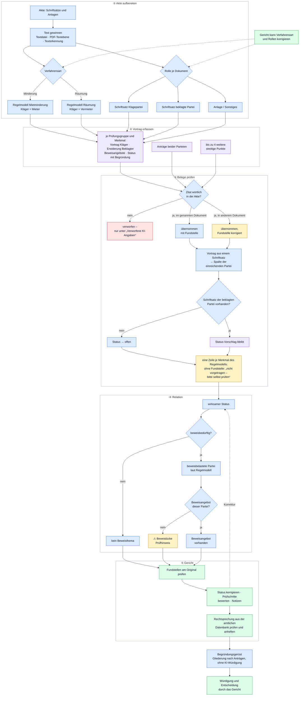

**Lesehilfe:**

1. **Akte aufbereiten:** Aus allen Dateien wird Text gewonnen. Die Verfahrensart bestimmt, welches Regelmodell (Merkmale, Normen, Beweislast) gilt. Jedes Dokument erhält eine Rolle – Schriftsatz einer Partei oder Anlage (Einzelheiten in 9.2). Beides kann das Gericht korrigieren.
2. **Vortrag erfassen:** Die KI ordnet den Vortrag den Merkmalen zu, schlägt einen Status vor und erfasst Beweisangebote und Anträge.
3. **Belege prüfen:** Jedes Zitat wird gegen die Akte geprüft; nicht auffindbare Angaben werden ausgesondert. Danach greifen feste Regeln: Vortrag aus einem Schriftsatz wird immer der einreichenden Partei zugeordnet; ohne Klageerwiderung ist jeder Status „offen“; jedes Merkmal erhält eine Zeile.
4. **Relation:** Aus dem Status folgt die Beweisbedürftigkeit, aus dem Regelmodell die Beweislast, aus beidem gegebenenfalls ein Hinweis auf eine Beweislücke.
5. **Gericht:** Das Gericht prüft die Fundstellen, korrigiert den Status (die Korrektur wirkt zurück auf Schritt 4), bewertet die Prüfschritte und heftet Rechtsprechung an. Das Begründungsgerüst fasst dies als Gliederung zusammen; die Würdigung bleibt dem Gericht vorbehalten.

### 9.2 Rolle eines Dokuments: Schriftsatz oder Anlage?

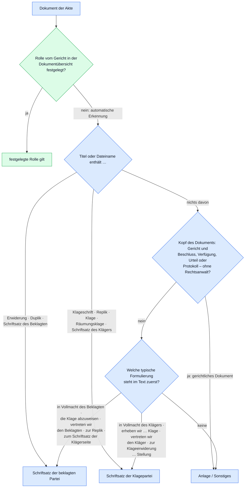

**Lesehilfe:** Eine Festlegung des Gerichts hat immer Vorrang. Sonst prüft die Anwendung zuerst Titel und Dateinamen, und zwar zuerst auf Schriftsätze der beklagten Partei (damit „Klageerwiderung“ nicht als „Klage“ gelesen wird). Hilft das nicht weiter, werden gerichtliche Dokumente aussortiert und anschließend die ersten Zeilen des Textes nach typischen Formulierungen durchsucht; entscheidend ist, welche Formulierung **zuerst** vorkommt.

### 9.3 Vortrag, Beweismittel und Art des Beweismittels

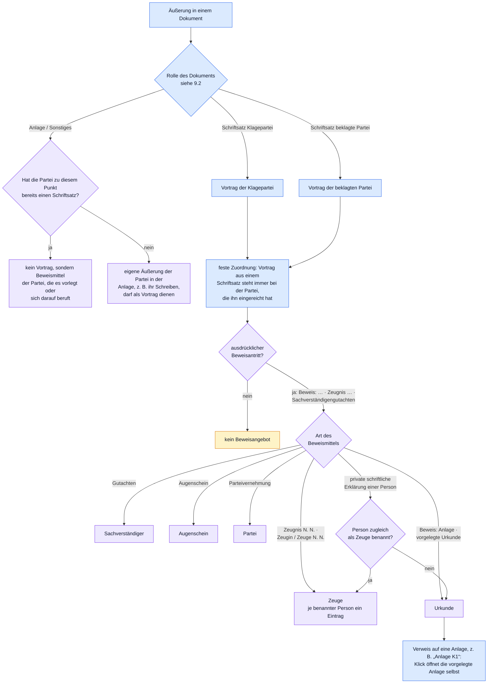

**Lesehilfe:** Parteivortrag kommt aus den Schriftsätzen; Anlagen sind grundsätzlich Beweismittel. Die einzige Ausnahme: Hat eine Partei zu einem Punkt noch keinen Schriftsatz, darf ihre eigene Äußerung in einer Anlage als Vortrag dienen. Als Beweisangebot zählt nur ein **ausdrücklicher Beweisantritt**. „Zeugnis N. N.“ ist immer Zeugenbeweis; die schriftliche Erklärung einer Person ist eine Urkunde, solange die Person nicht selbst als Zeuge benannt wird. Die violetten Schritte nimmt die KI nach diesen Vorgaben vor; die blauen setzt die Anwendung selbst durch.

### 9.4 Status nach der ZPO

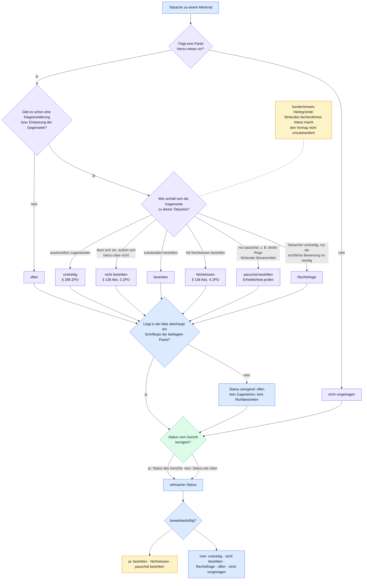

**Lesehilfe:** Den Status schlägt die KI nach einer festen Entscheidungsfolge vor (violett). Danach greift eine feste Regel: Gibt es in der Akte keinen Schriftsatz der beklagten Partei, kann nichts zugestanden oder unbestritten sein – der Status wird dann zwingend „offen“. Zuletzt kann das Gericht den Status korrigieren; der so ermittelte **wirksame Status** entscheidet über die Beweisbedürftigkeit. „Pauschal bestritten“ gilt vorsorglich als beweisbedürftig – ob das Bestreiten nach § 138 Abs. 2 ZPO unbeachtlich ist, beurteilt das Gericht.

### 9.5 Beweislast und Beweislücke

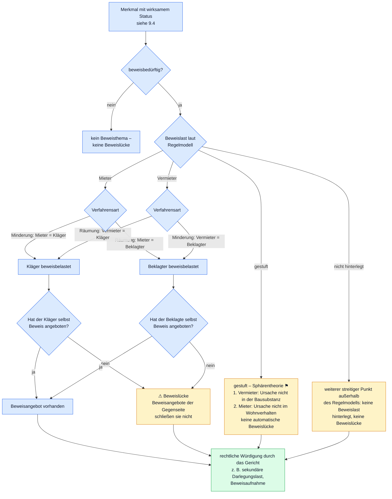

**Lesehilfe:** Das Regelmodell nennt die Beweislast in materiell-rechtlichen Rollen (Mieter oder Vermieter). Die Anwendung übersetzt sie anhand der Verfahrensart in die Prozessrolle: Bei der Mietminderung klagt der Mieter, bei der Räumung der Vermieter. Eine Beweislücke wird nur angezeigt, wenn der Punkt beweisbedürftig ist und **gerade die beweisbelastete Partei** keinen Beweis angeboten hat. Bei gestufter Beweislast und bei Punkten außerhalb des Regelmodells unterbleibt der Hinweis. Die Beweislücke ist ein Prüfhinweis und ersetzt keine rechtliche Würdigung.

### 9.6 Prüfungsaufbau: Mietminderung, Rückzahlung, Mängelbeseitigung

> **Hinweis zu 9.6 und 9.7:** Diese Diagramme geben die **Gliederung des Regelmodells** wieder, einschließlich der Obersätze und Hinweise aus dem Prüfungsschema (Abschnitt 6). Die Rauten sind **Prüfungsfragen, die das Gericht beantwortet**. Die Anwendung verknüpft die Ergebnisse einzelner Merkmale nicht und zieht aus ihnen keine Schlüsse; das Gericht hält sein Ergebnis je Prüfschritt als „erfüllt“, „nicht erfüllt“ oder „offen“ fest. Mit ⚑ markierte Elemente sind vom Team juristisch zu verifizieren.

**a) Welche Merkmale gehören zu welchem Klageantrag?** ⚑ Zuordnung vom Team zu verifizieren

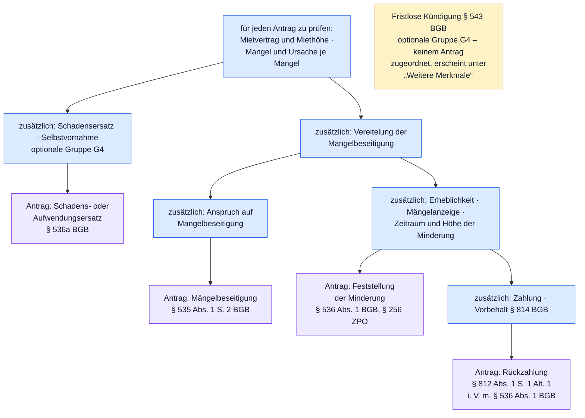

**Lesehilfe:** Das Diagramm liest sich von oben nach unten: Jeder Antrag umfasst alle Merkmale auf dem Weg von „für jeden Antrag zu prüfen“ bis zu ihm. Der **Rückzahlungsantrag** etwa umfasst Mietvertrag, Mangel und Ursache, Vereitelung, Erheblichkeit, Anzeige, Zeitraum und Höhe sowie Zahlung und Vorbehalt. Die KI erkennt die gestellten Anträge (violett) und ordnet sie einem Antragstyp zu; welche Merkmale zu dem Typ gehören, legt das Regelmodell fest (blau). Ein Merkmal, das mehrere Anträge betrifft, wird in der Übersicht mit „auch Antrag …“ gekennzeichnet und im Begründungsgerüst nur einmal ausgeführt.

**b) Prüfungsablauf der Minderung**

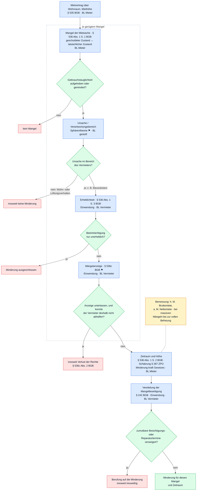

**Lesehilfe:** Die Prüfung beginnt mit dem Mietvertrag. Für **jeden gerügten Mangel** (z. B. „Schimmel Schlafzimmer“, „Lärm Nachbarwohnung“) werden Mangel, Ursache, Erheblichkeit und Anzeige gesondert erfasst. Anspruchsbegründende Tatsachen hat der Mieter zu beweisen, Einwendungen (Unerheblichkeit, unterlassene Anzeige, Vereitelung) der Vermieter; bei der Ursache gilt die gestufte Beweislast der Sphärentheorie. Die Minderung tritt kraft Gesetzes ein, eine Minderungserklärung ist nicht erforderlich. Stört ein Mitmieter, weist das Prüfungsschema darauf hin, dass gegen ihn nur §§ 823, 1004, 858 ff. BGB in Betracht kämen; das Verhältnis zum Vermieter bleibt unberührt.

**c) Die einzelnen Klageanträge**

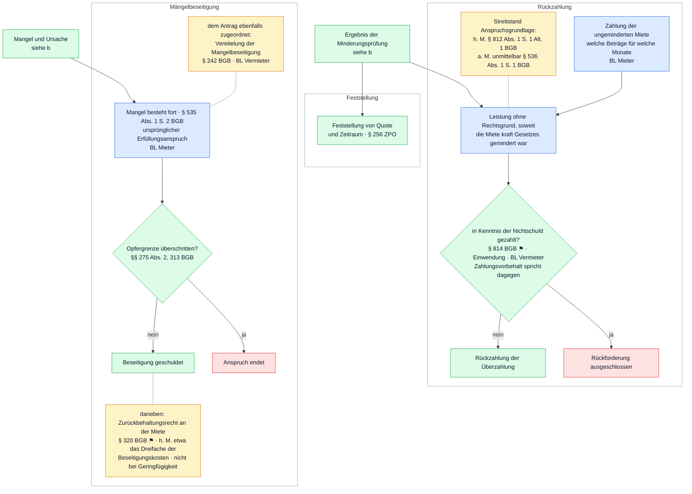

**Lesehilfe:** Der **Rückzahlungsantrag** setzt die Minderung (b) voraus und fügt die Zahlung sowie die Einwendung des § 814 BGB hinzu; zur Anspruchsgrundlage ist ein Streitstand hinterlegt. Der **Feststellungsantrag** stützt sich allein auf das Ergebnis der Minderungsprüfung. Der **Beseitigungsantrag** braucht Mangel und Ursache, nicht aber Erheblichkeit, Anzeige oder Minderungsquote; er endet an der Opfergrenze. Das Regelmodell ordnet ihm zusätzlich das Merkmal „Vereitelung der Mangelbeseitigung“ zu; welche Folge eine Vereitelung für den Beseitigungsanspruch hat, legt das Prüfungsschema nicht fest. Das Zurückbehaltungsrecht ist als Hinweis hinterlegt.

**d) Optionale Gruppe G4: Weitere Anspruchsgrundlagen** – wird nur analysiert, wenn das Gericht die Gruppe für die Akte einschaltet; alle Merkmale ⚑, BL jeweils Mieter

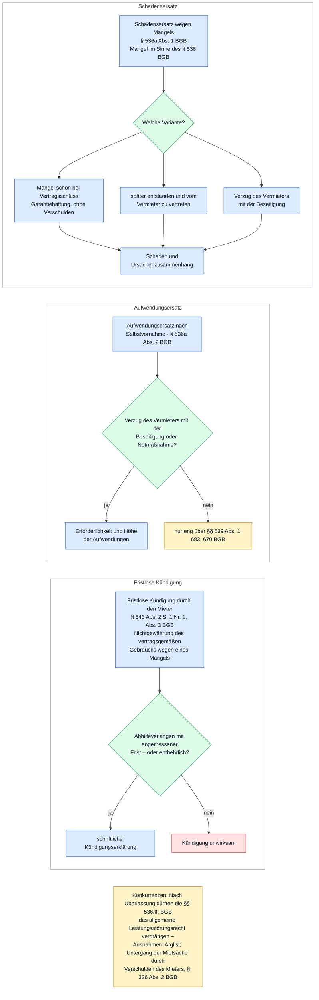

**Lesehilfe:** Die Gruppe enthält drei weitere Anspruchsgrundlagen. Schadensersatz kennt drei Varianten, von denen nur der anfängliche Mangel verschuldensunabhängig ist (Garantiehaftung). Aufwendungsersatz setzt grundsätzlich Verzug des Vermieters voraus. Die fristlose Kündigung ist keinem Antragstyp zugeordnet und erscheint in der Übersicht unter „Weitere Merkmale“.

### 9.7 Prüfungsaufbau: Räumung nach Eigenbedarfskündigung

```mermaid
flowchart TD
  classDef regel fill:#dbeafe,stroke:#2563eb,color:#0f172a
  classDef gericht fill:#dcfce7,stroke:#16a34a,color:#0f172a
  classDef hinweis fill:#fef3c7,stroke:#d97706,color:#0f172a
  classDef aus fill:#fee2e2,stroke:#dc2626,color:#0f172a

  AN["Antrag: Räumung und Herausgabe<br/>§§ 546 Abs. 1, 985 BGB"]:::regel

  subgraph G1["G1 Wirksame Kündigung"]
    K1["Mietverhältnis und Überlassung<br/>§§ 535, 546 Abs. 1 BGB<br/>BL Vermieter für G1"]:::regel
    K2["Schriftform, eigenhändige Unterschrift<br/>§§ 568 Abs. 1, 126 BGB<br/>mehrere Beteiligte: von allen, an alle ⚑"]:::regel
    K3["Zugang · § 130 BGB ⚑"]:::regel
    K4["Gründe im Kündigungsschreiben<br/>§ 573 Abs. 3 BGB ⚑"]:::regel
    K5["Kündigungsfrist · § 573c Abs. 1 BGB ⚑<br/>zu früher Termin wirkt<br/>zum nächstzulässigen"]:::regel
    KB["befristetes Mietverhältnis · § 575 BGB ⚑<br/>berechtigtes Interesse an der Beendigung,<br/>sonst Fortsetzungsverlangen des Mieters"]:::hinweis
    K1 --> K2 --> K3 --> K4 --> K5
    K5 -->|"nur wenn die Akte eine<br/>Befristung erwähnt"| KB
  end
  QK{"Kündigung<br/>wirksam?"}:::gericht

  subgraph G2["G2 Eigenbedarf"]
    E1["Bedarfsperson · § 573 Abs. 2 Nr. 2 BGB<br/>Vermieter, Familien- oder<br/>Haushaltsangehörige · BL Vermieter"]:::regel
    E2["ernsthafter, konkreter Nutzungswille<br/>keine bloße Vorratskündigung · BL Vermieter"]:::regel
    E3["vernünftige, nachvollziehbare Gründe<br/>Lebensplanung nicht durch eigene<br/>Vorstellungen ersetzen · BL Vermieter"]:::regel
    E4["Alternativwohnung / Anbietpflicht<br/>§ 242 BGB ⚑ · BL Mieter<br/>sekundäre Darlegungslast Vermieter"]:::regel
    E5["Sperrfrist nach Umwandlung<br/>§ 577a BGB · BL Mieter"]:::regel
    E1 --> E2 --> E3 --> E4 --> E5
  end
  GG["Art. 14 GG schützt beide Seiten:<br/>Eigentum des Vermieters und<br/>Besitzrecht des Mieters"]:::hinweis
  QE{"Eigenbedarf begründet und Kündigung<br/>nicht ausgeschlossen – Rechtsmissbrauch ⚑,<br/>Sperrfrist?"}:::gericht

  subgraph G3["G3 Widerspruch und Härte"]
    H1["Widerspruch: Schriftform und Frist<br/>§ 574b BGB · Belehrung § 568 Abs. 2 BGB ⚑<br/>BL Mieter für G3"]:::regel
    QW{"Widerspruch<br/>wirksam?"}:::gericht
    H2["Härtegründe · § 574 Abs. 1 BGB<br/>Alter, Gesundheit, Verwurzelung, Mietdauer<br/>fachärztliches Attest nicht zwingend"]:::regel
    H3["kein zumutbarer Ersatzwohnraum<br/>§ 574 Abs. 2 BGB ⚑<br/>Suchbemühungen, Marktlage"]:::regel
    H4{"Abwägung: Härte für den Mieter<br/>gegen Erlangungsinteresse<br/>des Vermieters"}:::gericht
    H1 --> QW
    QW -->|"ja"| H2 & H3
    H2 & H3 --> H4
  end

  X1["Räumungsanspruch<br/>nicht begründet"]:::aus
  R["Räumung und Herausgabe"]:::gericht
  F["Fortsetzung des Mietverhältnisses<br/>§ 574 BGB"]:::aus

  AN --> K1
  K5 --> QK
  KB --> QK
  QK -->|"nein"| X1
  QK -->|"ja"| E1
  GG -.- E3
  E5 --> QE
  QE -->|"nein"| X1
  QE -->|"ja"| H1
  QW -->|"nein"| R
  H4 -->|"Härte nicht zu rechtfertigen"| F
  H4 -->|"Interesse des Vermieters<br/>überwiegt"| R
  style G1 fill:none,stroke:#94a3b8
  style G2 fill:none,stroke:#94a3b8
  style G3 fill:none,stroke:#94a3b8
```

**Lesehilfe:** Die Prüfung folgt dem klassischen Aufbau: zuerst die **Wirksamkeit der Kündigung** (Form, Zugang, Begründung, Frist), dann der **Kündigungsgrund Eigenbedarf** mit den Gegenrechten des Mieters (Anbietpflicht, Sperrfrist), schließlich **Widerspruch und Härte** nach der Sozialklausel. Die Beweislast liegt für die Kündigung und den Eigenbedarf beim Vermieter, für Gegenrechte, Widerspruch und Härte beim Mieter. Das Merkmal „Befristetes Mietverhältnis“ wird nur geprüft, wenn die Akte eine Befristung erwähnt.

> **⚑ Hinweis für die juristische Prüfung des Regelmodells:** Das Regelmodell ordnet die Verletzung der Anbietpflicht als Rechtsmissbrauch (§ 242 BGB) ein, der die Kündigung ausschließen könnte. Nach der Rechtsprechung des BGH (Urt. v. 14.12.2016 – VIII ZR 232/15) führt ein Verstoß gegen die Anbietpflicht jedoch nicht zur Unwirksamkeit der Eigenbedarfskündigung, sondern kann lediglich Schadensersatzansprüche des Mieters begründen. Diese Einordnung sollte bei der Verifikation des Regelmodells überprüft werden.

### 9.8 Belegprinzip bei der Rechtsprechung

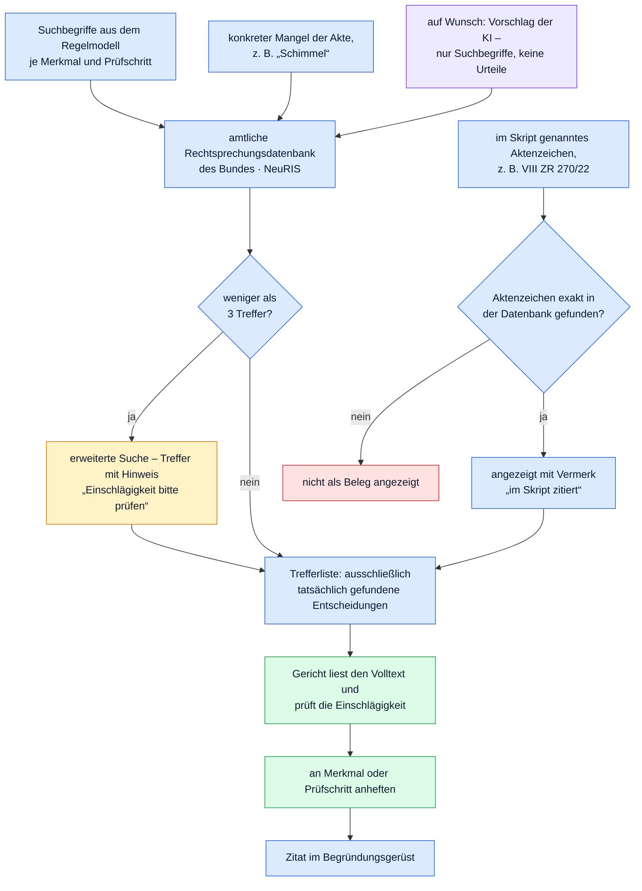

**Lesehilfe:** Die KI kann allenfalls Suchbegriffe beisteuern; jede angezeigte Entscheidung stammt aus der amtlichen Datenbank. Im Skript genannte Aktenzeichen werden nur übernommen, wenn die Datenbank genau dieses Aktenzeichen liefert. In das Begründungsgerüst gelangen nur Entscheidungen, die das Gericht selbst geprüft und angeheftet hat.

🔧 Exkurs für Informatiker: Pflege der Diagramme

Die Diagramme sind in [Mermaid](https://mermaid.js.org/) geschrieben und stehen als Quelltext direkt in dieser Datei; GitHub stellt sie beim Anzeigen als Grafik dar. Sie bilden das Regelmodell (`RULES`, `PRUEFUNG`, `ANTRAEGE`) und die Logik von `runAnalysis()`, `verifyItem()`, `docSideAuto()`, `effStatus()`, `sideOf()` und `proofGap()` ab und müssen bei Änderungen dort von Hand nachgezogen werden. Hinweise zur Syntax: Ein Knotentext, der mit „+ “, „- “ oder „1. “ beginnt, wird als Markdown-Liste gedeutet und nicht dargestellt; lange Gruppentitel (`subgraph`) werden abgeschnitten, deshalb stehen Normen und Beweislast in den Knoten.

---

## 10. Datenschutz, Vertraulichkeit, Speicherort

> **Wichtig:** Die Anwendung sendet den **vollständigen Text der Akte** an einen externen KI-Anbieter (Claude von Anthropic oder – je nach Einstellung – über OpenRouter an Anthropic, OpenAI oder Google). Die Anwendung weist selbst darauf hin, dass sie **nur für synthetische Übungsakten** bestimmt ist. Für echte Verfahrensakten wären vor einem Einsatz insbesondere datenschutzrechtliche Fragen (DSGVO, bereichsspezifisches Justizdatenschutzrecht), die Wahrung des Beratungs- und Dienstgeheimnisses sowie die Vorgaben der Justizverwaltung zum Einsatz externer KI-Dienste zu klären.

Was wohin gelangt:

| Daten | Ziel |
|---|---|
| Text aller lesbaren Dokumente, Aktenzeichen, Parteinamen | KI-Anbieter (bei jeder Analyse) |
| Merkmal, Mangelbezeichnung, Kurzfassungen des Vortrags | KI-Anbieter (nur bei „✨ KI-Suchbegriffe“) |
| Suchbegriffe, Aktenzeichen aus dem Skript | amtliche Rechtsprechungsdatenbank des Bundes |
| Akten, **Originaldateien**, Analysen, Prüfvermerke, Texterkennungsergebnisse | **lokal im Browser** dieses Rechners |
| OpenRouter-Schlüssel und Einstellungen | lokal im Browser dieses Rechners |

Es gibt **keinen eigenen Server** der Anwendung. Die Akten bleiben im Browser des jeweiligen Rechners gespeichert, bis sie über „Akte entfernen“ gelöscht oder die Browserdaten geleert werden. Sie sind auf anderen Rechnern oder für andere Personen nicht sichtbar. Umgekehrt bedeutet das: Wer Zugriff auf das Benutzerkonto des Rechners hat, kann die gespeicherten Akten einsehen.

Für die Darstellung lädt die Anwendung außerdem Schriftarten (Google Fonts) sowie Programmbibliotheken für PDF-Anzeige, Texterkennung und ZIP-Archive von öffentlichen Servern nach.

🔧 Exkurs für Informatiker: Speicherung im Browser

- **IndexedDB** `team9-streitstand` (Version 2) mit den Speichern `akten` (Schlüssel `id`), `files` (Originaldateien je Akte als `File`-Objekte) und `ocr` (OCR-Ergebnisse je Datei-Signatur `Pfad|Größe|Änderungsdatum[|Seite]`). Ohne IndexedDB arbeitet die Anwendung nur im Arbeitsspeicher (`DB.mem`, `streitstand_v3_1.html:880`).
- Zusätzlich legt die Texterkennung ihre Sprachdaten in der IndexedDB `keyval-store` ab.
- **localStorage**: `t9_provider`, `t9_tier`, `t9_key` (OpenRouter-Schlüssel, **im Klartext**), `t9_model`, `t9_ris`, `t9_example_loaded`.
- Der Export (`exportAkte()`, `:2615`) nutzt die Download-Funktion der Claude-Artefakt-Laufzeit (`window.claude.use('downloads')`) und steht in der lokal geöffneten Datei nicht zur Verfügung.

---

## 11. Grenzen und Fehlerquellen

Die folgenden Punkte sollten beim Arbeiten mit der Anwendung stets bedacht werden:

1. **Die Kurzfassungen und Status sind KI-Vorschläge.** Belegt ist nur, dass das Zitat in der Akte steht – nicht, dass die Kurzfassung es richtig wiedergibt, dass es zum Merkmal gehört oder dass der Status zutrifft. Jede für die Entscheidung erhebliche Angabe sollte über den Klick auf die Fundstelle am Original nachvollzogen werden.
2. **Fehlender Vortrag ist möglich.** Hat die KI einen Vortrag übersehen, erscheint er nicht. Merkmale ohne Fundstelle werden ausdrücklich als „nicht vorgetragen – bitte selbst prüfen“ ausgewiesen, eine Vollständigkeitsgarantie gibt es aber nicht.
3. **Verworfene Angaben ansehen.** Im Bereich „Verworfene KI-Angaben“ können sich zutreffende Inhalte befinden, die nur ungenau zitiert waren.
4. **Das Regelmodell ist nicht abschließend geprüft.** Beweislastregeln, Antragszuordnungen und Prüfungsschemata mit „⚑ vom Team zu verifizieren“ sind ausdrücklich vorläufig.
5. **Rollenerkennung der Dokumente.** Wird ein Schriftsatz nicht als solcher erkannt (oder eine Anlage fälschlich als Schriftsatz), verschiebt sich die Zuordnung von Vortrag und Beweismitteln. Die Rolle in der Dokumentübersicht kontrollieren und ggf. korrigieren.
6. **Texterkennung.** Bei schlechten Scans kann Text fehlen oder falsch erkannt sein. Warnungen („⚠ kaum Text“, „nicht ausgewertet“) beachten.
7. **Erkennung der Verfahrensart** beruht auf wenigen Stichworten; bei gemischten Sachverhalten (z. B. Minderung und Räumung) manuell festlegen.
8. **Beweislücke** ist ein rein formaler Hinweis (beweisbedürftig + beweisbelastet + kein Angebot) und ersetzt keine rechtliche Prüfung.
9. **Rechtsprechungsdatenbank im Aufbau.** Fehlende Treffer bedeuten nicht, dass es keine einschlägige Rechtsprechung gibt.
10. **Zwei Verfahrensarten.** Andere mietrechtliche Konstellationen (z. B. Zahlungsverzugskündigung, Mieterhöhung, Betriebskosten) sind nicht abgebildet.

---

## 12. Technischer Anhang (Exkurs für Informatiker)

🔧 Aufbau, Abhängigkeiten, Betrieb und Testschnittstelle

### Aufbau

Die gesamte Anwendung besteht aus **einer HTML-Datei** (`streitstand_v3_1.html`, ca. 2 850 Zeilen) mit eingebettetem CSS und JavaScript, ohne Build-Schritt und ohne Framework. Der Zustand liegt im Objekt `S` (`:914`); die Oberfläche wird durch `render()` / `renderSide()` / `renderMain()` / `renderPreviewShell()` als HTML-Zeichenketten neu erzeugt. Ereignisse werden zentral über Delegation auf `document` behandelt (`click`, `change`, `input`, `keydown`; ab `:2717`), gesteuert über `id`s und `data-*`-Attribute. Alle dynamischen Inhalte laufen durch `esc()`.

| Abschnitt | Zeilen (ca.) |
|---|---|
| CSS (Farbschema hell/dunkel, responsives Layout, Container-Queries) | 10–462 |
| Regelmodell `RULES`, `PRUEFUNG`, `ANTRAEGE`, `STATUS`, KI-Konfiguration | 485–870 |
| Hilfsfunktionen, IndexedDB, Zustand | 872–920 |
| Zitat-Suche (`findQuote`) | 922–967 |
| Einlesen (Ordner, ZIP, Markdown mit Front-Matter, Dokumentkennungen) | 969–1095 |
| PDF-Text und OCR | 1097–1208 |
| KI-Analyse (Prompts, Anbieter, Anker-Wächter, `runAnalysis`) | 1210–1613 |
| Rechtsprechung (NeuRIS) | 1615–1846 |
| Prüfungsbereich | 1848–2039 |
| Begründungsgerüst | 2041–2108 |
| Rendering (Tabelle, Antragsansicht, Vorschau mit Markierung) | 2110–2543 |
| Aktionen, Einstellungen, Beispielakte, Ereignisse, Start | 2545–2845 |
| Testschnittstelle `window.__T9` | 2848 |

### Externe Bibliotheken (per CDN)

- `pdf.js` 3.11.174 (cdnjs) – PDF-Darstellung, Textebene, Text-Layer für Markierungen
- `tesseract.js` 5.1.1 (jsDelivr) – Texterkennung, Sprache `deu`
- `JSZip` 3.10.1 (cdnjs) – Entpacken von ZIP-Archiven
- Google Fonts: Inter, JetBrains Mono

### KI-Anbieter

| Anbieter | Weg | Hinweise |
|---|---|---|
| Claude | `window.claude.use('sample')` der Claude-Artefakt-Laufzeit; `sample.json(prompt, { modelTier })` | nur, wenn die Seite als Artefakt in Claude läuft; Stufen `quick` („schnell“, Standard) und `default` („gründlich“) |
| OpenRouter | `POST https://openrouter.ai/api/v1/chat/completions`, `temperature: 0`, `max_tokens: 16000`, `reasoning.enabled: false` | Modelle: `anthropic/claude-haiku-5.5`, `openai/gpt-5.4-mini`, `google/gemini-3.1-flash-lite`; Schlüssel aus Einstellungen oder `.env` (`OPENROUTER_API_KEY=…`) |
| automatisch | OpenRouter, wenn ein Schlüssel hinterlegt und erreichbar ist, sonst Claude | Ist OpenRouter nicht erreichbar (typisch im veröffentlichten Artefakt), wird für die Sitzung auf Claude umgeschaltet |

Antworten werden als JSON erwartet; Code-Zäune werden entfernt, der Bereich zwischen erster `{` und letzter `}` wird geparst.

### Eingabeformat Markdown

Markdown-Dateien können einen Front-Matter-Block enthalten (`document_id`, `document_date`, `release`). Die erste Überschrift ist der Titel (ein Präfix `K01 | ` wird entfernt). Zeilen der Form `[M01:L02] Text` tragen einen Zeilenanker, der als Fundstelle angezeigt wird.

### Nicht im Repository enthaltene Begleitdateien

Die Anwendung greift optional auf Dateien neben der HTML-Seite zu, die in diesem Repository **nicht** enthalten sind:

- `beispiel/manifest.json`, `beispiel/analyse.json` und die darin gelisteten Dateien – Beispielakte „Westring“ (nur Online-Fassung; lokal erscheint ein Hinweis),
- `lang/deu.traineddata.gz.b64.txt` – deutsche OCR-Sprachdaten als Base64; fehlen sie, lädt Tesseract die Daten selbst aus dem Netz.

### Betrieb

- **Als Claude-Artefakt:** Analyse über Claude, Export möglich, OpenRouter i. d. R. nicht erreichbar.
- **Lokal (`file://`, Chrome/Edge):** Analyse nur über OpenRouter (Schlüssel nötig), kein Export, keine Beispielakte; die NeuRIS-Abfragen können am CORS-Verhalten des Browsers scheitern.
- **Über einen lokalen Webserver** (z. B. `python3 -m http.server` im Verzeichnis): vermeidet die `file://`-Einschränkungen bei Netzabfragen.

### Testschnittstelle

`window.__T9` (`:2848`) stellt für automatisierte Tests u. a. `S`, `RULES`, `PRUEFUNG`, `callLLM`, `analyze`, `runAnalysis`, `findQuote`, `buildDocs`, `openPreview`, `DB`, `memFiles`, `selectAkte`, `pruefQueries`, `runPruefRsp`, `risFileNumber`, `toggleStepPin`, `virtualRows`, `geruestHtml` bereit. Tests selbst sind im Repository nicht enthalten.

---

## 13. Glossar

| Begriff | Bedeutung in der Anwendung |
|---|---|
| **Akte** | ein Verfahren mit Aktenzeichen, Parteien, Verfahrensart und den eingelesenen Dokumenten |
| **Anker / Fundstelle** | Kürzel der Belegstelle, z. B. `M01:L04` (Dokument M01, Zeile 4) oder `K01 S.3` (Dokument K01, Seite 3); gelb = automatisch korrigiertes Dokument |
| **Anker-Wächter** | automatische Prüfung, ob ein KI-Zitat wörtlich in der Akte steht |
| **Begründungsgerüst** | druckbare Gliederung für die Entscheidungsgründe ohne KI-Würdigung |
| **Beweislücke** | beweisbedürftiger Punkt, zu dem die beweisbelastete Partei keinen Beweis angeboten hat |
| **Instanz** | bei „je Mangel“-Merkmalen die Bezeichnung des einzelnen Mangels (z. B. „Feuchtigkeit/Schimmel Schlafzimmer“) – nicht im prozessualen Sinne |
| **KI** | Sprachmodell eines externen Anbieters (Claude bzw. über OpenRouter), das den Vortrag erfasst |
| **NeuRIS** | Neues Rechtsinformationssystem des Bundes, amtliche Rechtsprechungsdatenbank |
| **OCR / Texterkennung** | maschinelles Lesen von Text aus Scans und Bildern |
| **Prüfvermerk** | vom Gericht gesetzte Angabe: geprüft, Status, Notiz, Status eines Prüfschritts, angeheftete Entscheidung |
| **Regelmodell** | fest hinterlegtes Prüfprogramm mit Merkmalen, Normen und Beweislast; auch Quellenangabe für Inhalte, die nicht aus dem Skript stammen |
| **Skript** | das Mietrechts-Skript, auf dessen Seiten die Prüfungsschemata verweisen (z. B. „Skript S. 52“) |
| **Weitere streitige Punkte** | bis zu vier von der KI zusätzlich erfasste Streitpunkte außerhalb des Regelmodells |
